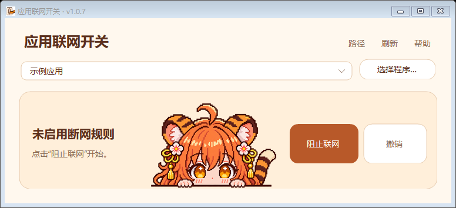

# TigerToggle · 虎爪开关

给指定的 Windows 程序加一道出站联网开关。选中程序，点击「阻止联网」，需要恢复时再点击「撤销」。

## 下载与使用

在仓库的 [Releases（发布版本）](https://github.com/StarBulb0502/TigerToggle/releases/tag/v1.0.7)中下载 `v1.0.7` 的 `AppNetworkSwitch-1.0.7-Windows.zip`。解压后双击 `AppNetworkSwitch.exe` 即可打开。运行环境为 Windows 10 / 11 和 .NET Framework 4.8。

1. 从下拉框选一个应用，或用「选择程序」定位它的 `.exe` 文件。
2. 点击「阻止联网」，阅读提示并完成 Windows 管理员授权。
3. 保存工作并重新打开目标程序，检查实际联网状态。
4. 恢复时选回同一个程序，点击「撤销」。

## 规则与卸载

- Windows 防火墙按所选 EXE 的完整路径限制出站连接。辅助进程可以单独设置，程序升级后路径变化时需要重新选择。
- 限制覆盖互联网和局域网连接，登录、更新和云功能可能受到影响。
- 关闭工具后，已启用的规则仍保存在本机。清理时先逐项撤销由本工具创建的规则，再删除解压文件夹。
- ZIP 提供 SHA-256 校验值。EXE 尚未进行数字签名，Windows 可能显示未知发布者。

## 从源码构建

在 Windows 上运行 `source\build.cmd`。脚本会调用 .NET Framework 编译器，在仓库根目录生成 `AppNetworkSwitch.exe`。源码使用 Windows Forms 界面和 Windows 防火墙系统接口。

程序启动时在本机扫描应用安装记录与常见目录，并读取当前防火墙规则。使用过程中，应用路径和规则保存在使用者自己的电脑上。
